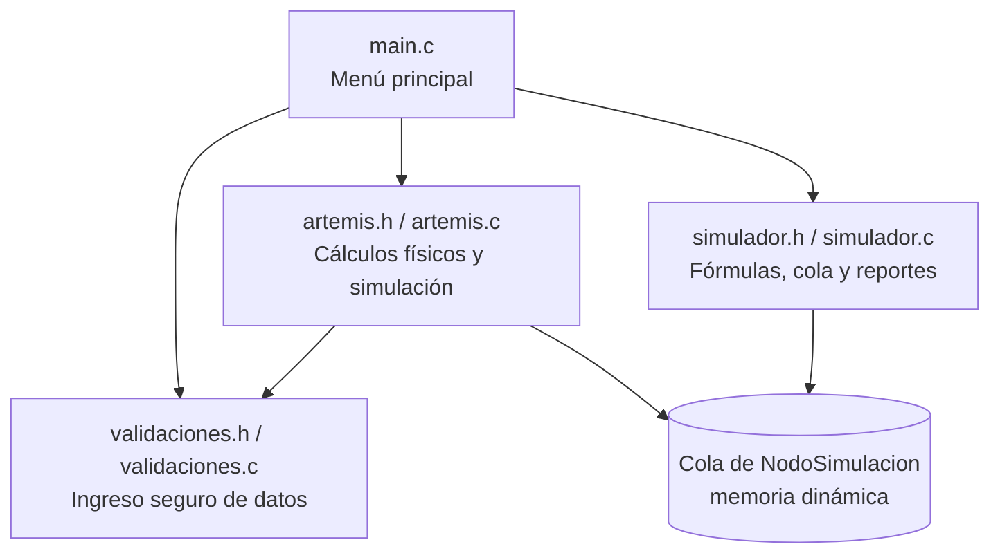

# Simulador de Misiones Artemis — Órbita Terrestre Baja (LEO)

**UTN – Facultad Regional Resistencia**
Cátedra: Algoritmos y Estructuras de Datos — Ingeniería en Sistemas de Información
Trabajo Práctico Integrador Final — Lenguaje C

---

## a) Integrantes y comisión

| Integrante | Usuario de GitHub | Módulo a cargo |
|---|---|---|
| Brittez Octavio Agustín | `@tezbrit` | `main.c`, `simulador.h` y `simulador.c` |
| Gonzalez Agustín | `@1zgus` | Módulo de cabecera (`artemis.h`) y README |
| Miranda Jerónimo | `@jeritox123` | Módulo de lógica (`artemis.c`) |
| COMPLETAR | `@ulisesivan123` | COMPLETAR |

**Comisión:** K1.1 / ISI A

---

## b) Escenario asignado: Situación Problema 2 — Inserción y estabilidad en órbita LEO

Tras apagar sus motores de ascenso, la nave **Orion** es inyectada en una órbita terrestre baja (LEO) de estacionamiento, donde realiza un **Movimiento Circular Uniforme (MCU)** a una altitud constante de **h = 192 km** sobre la superficie terrestre.

**Datos del problema**

| Magnitud | Valor (SI) | Valor usado en el programa (CGS) |
|---|---|---|
| Masa de la Tierra (MT) | 5,972 × 10²⁴ kg | 5,972 × 10²⁷ g |
| Radio terrestre medio (RT) | 6.371.000 m | 6,371 × 10⁸ cm |
| Altitud de la órbita (h) | 192.000 m | 1,92 × 10⁷ cm |
| Radio orbital (r = RT + h) | 6.563.000 m | 6,563 × 10⁸ cm |
| Constante de gravitación (G) | 6,674 × 10⁻¹¹ N·m²/kg² | 6,674 × 10⁻⁸ cm³/(g·s²) |
| Masa de Orion | 33.000 kg | 3,3 × 10⁷ g |
| Aceleración del propulsor lateral | 0,50 m/s² | 50 cm/s² |
| Duración del pulso (Δt) | 10 s | 10 s |

**Preguntas que resuelve el simulador**

1. Demostrar que la fuerza gravitatoria actúa como fuerza centrípeta y calcular la velocidad orbital necesaria.
2. Calcular el período orbital T en segundos y minutos.
3. Calcular la aceleración centrípeta que experimentan los astronautas.
4. Describir la trayectoria y calcular la desviación lateral producida por un pulso de propulsión perpendicular a la velocidad.

**Modelo físico**

- Gravedad como fuerza centrípeta: `G·MT·m / r² = m·v² / r`  ⇒  `v = √(G·MT / r)` (la masa de la nave se cancela).
- Período: `T = 2π·r / v`
- Aceleración centrípeta: `ac = v² / r`
- Desviación lateral (aceleración constante perpendicular partiendo de velocidad lateral nula): `d = ½·a·Δt²`

**Resultados de referencia con los datos de la consigna**

| Magnitud | Resultado |
|---|---|
| Velocidad orbital | ≈ 7.793 m/s |
| Período orbital | ≈ 5.291 s ≈ 88,2 min |
| Aceleración centrípeta | ≈ 9,25 m/s² (≈ 0,94 g) |
| Fuerza gravitatoria sobre Orion | ≈ 3,05 × 10⁵ N |
| Desviación lateral tras el pulso | 25 m (velocidad lateral ganada: 5 m/s) |

**Reglas del juego / simulación**

El programa funciona con un menú principal con 3 opciones y la opción de salir:

    1) Simular con mis propios datos: el usuario ingresa la altitud de la órbita (entre 160 km y 2.000 km) y la duración del pulso lateral. El programa calcula velocidad orbital, período, aceleración centrípeta y desviación lateral, y guarda el resultado en el historial.
    2) Resolver el caso de la consigna: responde las 4 preguntas del enunciado con los datos originales (h = 192 km, m = 33.000 kg, a = 0,50 m/s², Δt = 10 s) y los muestra en unidades SI. Verifica que la fuerza gravitatoria y la fuerza centrípeta dan el mismo valor. También guarda el resultado en el historial.
    3) Ver historial: muestra una tabla con todas las simulaciones hechas en la sesión, en el orden en que se hicieron (es una cola: la primera que entra es la primera que se muestra).
    0) Salir: libera la memoria de la cola y termina el programa.

Cómo ingresar la altitud: el programa trabaja en CGS, entonces la altitud se escribe en centímetros. Para 192 km se escribe 19200000 (o 1.92e7).

Restricciones de dominio que valida el programa:
- La altitud debe estar entre **160 km y 2.000 km** (rango LEO). Por debajo, el rozamiento atmosférico impide mantener la órbita.
- Las masas, aceleraciones y tiempos ingresados deben ser positivos.

---

## c) Funcionamiento y arquitectura

### Estructura de archivos

```
.
├── main.c            # Función main(), menú principal y flujo general
├── simulador.h       # Prototipos de: resolver_caso_consigna, mostrar_historial, contar_estados
├── simulador.c       # Fórmulas físicas, manejo de la cola (encolar/liberar_cola) y reportes
├── artemis.h         # Constantes, struct NodoSimulacion y prototipos de la simulación
├── artemis.c         # Cálculos físicos, manejo de la cola y lógica de la simulación
├── validaciones.h    # Prototipos de ingreso seguro de datos
├── validaciones.c    # Lectura validada de enteros, flotantes y caracteres
├── Makefile          # Compilación del proyecto
└── README.md
```

### Diagrama de módulos



### Estructura de datos

Cada estado de la simulación se guarda en un nodo de una **cola enlazada** con memoria dinámica:

```c
typedef struct NodoSimulacion {
    double altitud;              /* [cm]   */
    double velocidad;            /* [cm/s] */
    double desviacion;           /* [cm]   */
    struct NodoSimulacion* prox;
} NodoSimulacion;
```

Las funciones que modifican la cola reciben punteros dobles (`NodoSimulacion** prim`, `NodoSimulacion** ult`) para poder actualizar el primer y el último nodo desde dentro de la función. Al terminar, `liberar_cola` libera toda la memoria reservada.

### Funciones principales (`artemis.h`)

| Función | Descripción |
|---|---|
| `velocidad_orbital(r)` | Devuelve `√(G·MT / r)` |
| `periodo_orbital(r, v)` | Devuelve `2π·r / v` |
| `aceleracion_centripeta(v, r)` | Devuelve `v² / r` |
| `fuerza_gravitatoria(m, r)` | Devuelve `G·MT·m / r²` |
| `desviacion_lateral(a, dt)` | Devuelve `½·a·dt²` |
| `encolar(prim, ult, ...)` | Agrega un estado al final de la cola |
| `liberar_cola(prim, ult)` | Libera todos los nodos y deja los punteros en `NULL` |
| `ejecutar_simulacion(prim, ult)` | Ejecuta el ciclo de simulación |

Internamente todos los cálculos se hacen en CGS; los resultados se muestran al usuario en SI.

---

## d) Compilación y ejecución

Requisitos: `gcc` y `make`.

```bash
# Compilar
make

# Ejecutar
./artemis

# Borrar archivos generados
make clean
```

Compilación manual sin Makefile:

```bash
gcc -Wall -Wextra -o artemis main.c artemis.c validaciones.c -lm
```

> El flag `-lm` es necesario porque se usa `sqrt()` de `math.h`.
> En Windows el ejecutable se llama `artemis.exe`.

---

## e) Registro de uso de Inteligencia Artificial

Cada integrante registra acá las consultas que hizo a herramientas de IA, siguiendo el mismo formato.


### Brittez Octavio — COMPLETAR (herramienta)

| # | Tarea | Prompt / consulta | Qué se obtuvo | Cómo se validó / adaptó |
|---|---|---|---|---|
| 1 |	Primer intento: generar un simulador completo y plan de trabajo |"Actúa como un Senior C Developer y un Tutor Académico... desarrolla el simulador interactivo por consola en C... modularización: main.c, simulador.h, simulador.c, validaciones.h y validaciones.c... comenta casi cada línea... incluye un Glosario de Defensa". Se adjuntó el reglamento de la cátedra. |Un simulador completo con structs `Mision/Resultados`, validaciones propias y un plan de roles. |Se descartó el código: el grupo ya había definido otra arquitectura (cola enlazada con `NodoSimulacion`, unidades CGS, `artemis.h/.c`) y no encajaba. Se conservó solo la idea de comentar el código para poder defenderlo. |
| 2 |Entender cómo trabajar sin experiencia previa | "No tenemos suficiente conocimiento de GitHub, repositorios, trabajo remoto, IDE para C, cómo compilar ni ejecutar... proporciona la metodología más acorde para empezar este trabajo grupal y en qué IDE nos conviene". | Explicación desde cero de qué es compilar, IDE, repositorio y commit, y pasos para instalar un code::blocks y probar el programa. | el grupo decidió utilizar Visual Studio Code para mantener la interfaz intuitiva y usar la consola integrada del mismo para los commits y compilaciones |

### Gonzalez Agustín — Claude (Anthropic)

| # | Tarea | Prompt / consulta | Qué se obtuvo | Cómo se validó / adaptó |
|---|---|---|---|---|
| 1 | Análisis del escenario | Se compartió la consigna completa y la Situación Problema 2 (órbita LEO). | Resolución de las preguntas a–d con las fórmulas de MCU y gravitación, valores de referencia y una propuesta de arquitectura modular. | Se verificaron los cálculos a mano / con calculadora: v ≈ 7.793 m/s, T ≈ 88,2 min, ac ≈ 9,25 m/s², d = 25 m. COMPLETAR |
| 2 | Corrección de sintaxis de C (Punteros y lectura de datos) | "Ese es mi módulo, si quiero cambiarle algo no hay drama, respetar los nombres" + el `artemis.h` original del grupo. | Header revisado: guarda de inclusión corregida (`SIMULADOR_H` → `ARTEMIS_H`), constantes del escenario, rangos de validación, factores de conversión CGS→SI, prototipos de cálculo y de manejo de la cola (`encolar`, `liberar_cola`), comentarios con unidades. | Se comprobó que las constantes CGS coincidan con los datos de la consigna y que se mantuvieran los nombres ya usados por el grupo. Se consensuaron los prototipos con el resto del equipo. COMPLETAR |
| 3 | Armado del README | "Armar el README.md con todos los prompts" | Estructura del README con los puntos a–e de la consigna. | Se completaron integrantes, reglas del juego y registros del resto del equipo. COMPLETAR |

### Miranda Jerónimo — Gemini (pro)

| # | Tarea | Prompt / consulta | Qué se obtuvo | Cómo se validó / adaptó |
|---|---|---|---|---|
| 1 |Brindo infomacion al agente |"en el notebook que tenes adjunto tenes el documento'trabajo final integrador C' ese contiene todas las consignas que debe cumplir mi trabajo, los escenarios y lo que evaluará la profesora. Mi escenario es el nro 2 y yo me voy a encargar de el modulo de lógica, ya lo tengo hecho en pseudocodigo pero quiero que me ayudes a pasarlo al lenguaje C, te voy a ir mandando fragmentos de mi codigo pasado a C y me corregis si está algo mal explicandome por que esta mal y como debo cambiarlo" |"Perfecto Jerónimo, quedo a disposicion hasta que me envíes tu codigo para que podamos corregirlo juntos." |Se configuró el rol del agente exclusivamente como revisor de sintaxis. Se validó que la IA no generara la lógica desde cero, garantizando que el diseño original planteado en pseudocódigo se mantuviera intacto. |
| 2 |Control de rango y tipo de dato |"esta es la primera parte de artemis.c, ayudame a corregir lo que está mal: [Código con scanf("%f", h) y paso por valor de la lista]" |"Errores hallados: Faltan librerías importantes, la función no recibe punteros dobles, a los scanf les falta el & (lo que causaría un segmentation fault) y se usa %f en vez de %lf." |Se aplicaron las correcciones manuales en artemis.c: se actualizaron las firmas para recibir NodoSimulacion** (punteros dobles), se insertó el operador de dirección & para resguardar la memoria en las lecturas, y se ajustaron los formatos a %lf para los double. |
| 3 |Depuración de operadores aritméticos y salidas por consola |"segunda parte: // 2. Ejecución de algoritmos de simulación en MKS: ac = v^2 / r; [...] printf("Velocidad: %d m/s", v);" |"Errores hallados: Uso del símbolo ^ para elevar al cuadrado (en C es operación XOR de bits, no potencia), y usar %d (para enteros) al intentar imprimir un double." |Se modificó la aritmética del código reemplazando la sintaxis errónea de potencias por multiplicaciones algebraicas directas (ej: v * v y dt * dt). Se cambiaron todos los modificadores de printf a %.2f para mostrar correctamente las cifras decimales calculadas. |
| 4 |Corrección de manejo de memoria dinámica y listas enlazadas |"última parte: // 3. Actualización del estado: NodoSimulacion q = malloc(sizeof(NodoSimulacion)); q.altitud = h; [...] if (prim == NULL)" |"Errores hallados: Se declara 'q' sin el asterisco de puntero, se usa el punto . en lugar de la flecha -> para acceder a los campos, y no se desreferencian los punteros de la lista." |Se reestructuró la asignación dinámica usando NodoSimulacion* q. Se corrigió el acceso a las variables del struct adoptando el operador flecha (->) y se desreferenciaron los parámetros (*prim, *ult) para garantizar la persistencia del estado en la cola de simulación global. |

### Pereyra Ulises — Claude (Anthropic)

| # | Tarea | Prompt / consulta | Qué se obtuvo | Cómo se validó / adaptó |
|---|---|---|---|---|
| 1 |Validación de entrada de datos |"¿Cómo puedo validar la entrada de datos en C usando scanf para evitar que el programa entre en un bucle infinito si el usuario ingresa letras en lugar de números?" |Se obtuvo la técnica de limpieza de buffer de entrada estándar (stdin) utilizando un bucle while(getchar() != '\n'); para descartar caracteres residuales tras un fallo de lectura de scanf. |Se analizó el mecanismo de limpieza propuesto y se encapsuló dentro de la estructura de repetición do-while en las funciones del archivo validaciones.c, garantizando la reanudación segura de la solicitud de datos tras un ingreso inválido. |
| 2 |Control de rango y tipo de dato |"Necesito crear una función en C que pida un número 'double' por consola y valide que sea estrictamente positivo (mayor o igual a cero). Si ingresan caracteres o números negativos, debe limpiar el buffer de entrada y volver a pedir el dato." |Funciones de validación específicas utilizando el especificador de formato %lf para el tipo de dato double, con estructuras condicionales para evaluar restricciones de positividad y rangos numéricos acotados. |Se refactorizó el código sugerido para integrarlo con la arquitectura del simulador. Se reemplazaron los tipos primitivos genéricos por double para asegurar precisión en cálculos orbitales y se vincularon los parámetros de validación con las constantes macro H_MIN y H_MAX definidas en el archivo de cabecera artemis.h. |
| 3 |Modularización de la validación |"¿Cómo hago una función de validación modular en C que reciba un mensaje, un valor mínimo y un valor máximo por parámetro, y obligue al usuario a ingresar un 'double' que esté estrictamente dentro de ese rango?" |Una implementación modular que generaliza el proceso de solicitud, lectura, limpieza de buffer y evaluación condicional en una única función paramétrica, reduciendo la duplicación de código. |Las funciones generadas se organizaron separando la definición de prototipos en validaciones.h de la implementación lógica en validaciones.c. Posteriormente, se ejecutaron pruebas de validación locales ingresando caracteres alfabéticos, símbolos especiales y valores fuera de rango para confirmar la estabilidad del módulo antes de su integración. |


### Reflexión del equipo sobre el uso de IA

    - Se descartó el primer código generado porque no respetaba la arquitectura que el grupo ya había decidido. Aprendimos que la IA tiene que adaptarse al proyecto, y no al revés.
    - Al juntar los módulos aparecieron errores de integración: los prototipos de un .h no coincidían con las funciones del .c, y había funciones declaradas en artemis.h que nadie había escrito. Un archivo puede compilar por separado y fallar al unirlos.
    - Detectamos que validaciones.c acepta nan como número y que se cuelga si se cierra la entrada. [Se corrigió con ayuda de Claude que sugirió utilizar un `isFinite(valor)` para no permitir el ingreso de NAN y, para el caso del bucle infinito al cerrar el teclado, cambiamos el viejo `while` por `limpiarLinea()` y `entradaCerrada()` que se llama cuando `scanf` devuelve `EOF`, avisa y termina el programa con `exit(0)`]
