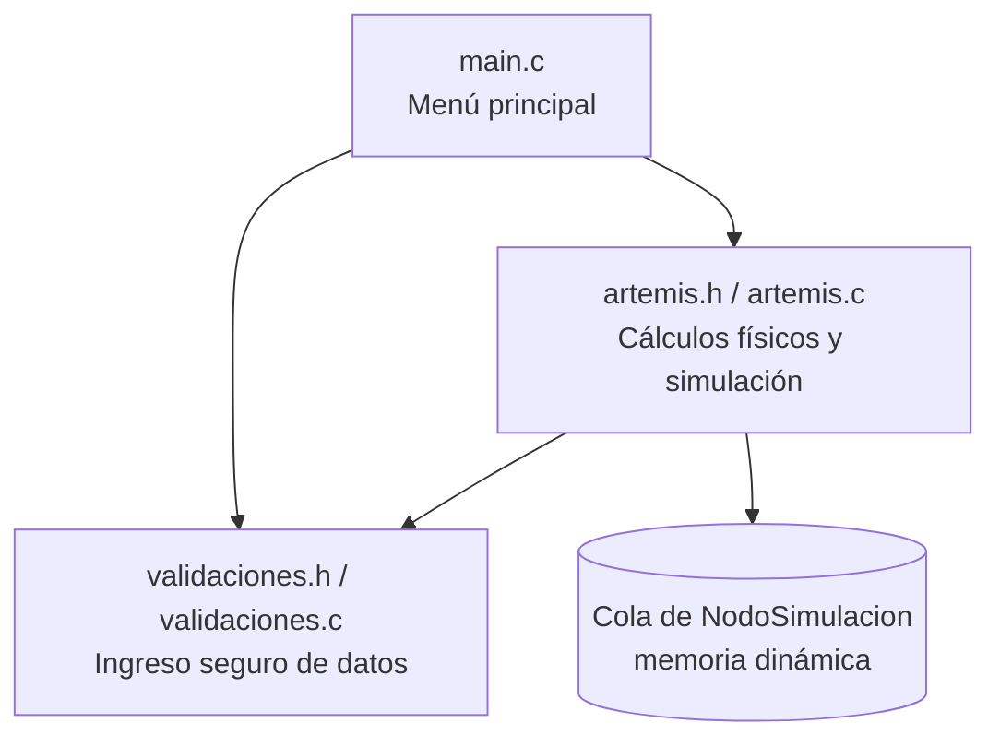

# Simulador de Misiones Artemis — Órbita Terrestre Baja (LEO)

**UTN – Facultad Regional Resistencia**
Cátedra: Algoritmos y Estructuras de Datos — Ingeniería en Sistemas de Información
Trabajo Práctico Integrador Final — Lenguaje C

---

## a) Integrantes y comisión

| Integrante | Usuario de GitHub | Módulo a cargo |
|---|---|---|
| Agus Gonzalez | `@COMPLETAR` | Módulo de cabecera (`artemis.h`) y README |
| COMPLETAR | `@COMPLETAR` | COMPLETAR |
| COMPLETAR | `@COMPLETAR` | COMPLETAR |
| COMPLETAR | `@COMPLETAR` | COMPLETAR |

**Comisión:** COMPLETAR

---

## b) Escenario asignado: Situación Problema 2 — Inserción y estabilidad en órbita LEO

Tras apagar sus motores de ascenso, la nave **Orion** es inyectada en una órbita terrestre baja (LEO) de estacionamiento, donde realiza un **Movimiento Circular Uniforme (MCU)** a una altitud constante de **h = 192 km** sobre la superficie terrestre.

**Datos del problema**

| Magnitud | Valor (SI) | Valor usado en el programa (CGS) |
|---|---|---|
| Masa de la Tierra (MT) | 5,972 × 10²⁴ kg | 5,972 × 10²⁷ g |
| Radio terrestre medio (RT) | 6.371.000 m | 6,371 × 10⁸ cm |
| Altitud de la órbita (h) | 192.000 m | 1,92 × 10⁷ cm |
| Radio orbital (r = RT + h) | 6.563.000 m | 6,563 × 10⁸ cm |
| Constante de gravitación (G) | 6,674 × 10⁻¹¹ N·m²/kg² | 6,674 × 10⁻⁸ cm³/(g·s²) |
| Masa de Orion | 33.000 kg | 3,3 × 10⁷ g |
| Aceleración del propulsor lateral | 0,50 m/s² | 50 cm/s² |
| Duración del pulso (Δt) | 10 s | 10 s |

**Preguntas que resuelve el simulador**

1. Demostrar que la fuerza gravitatoria actúa como fuerza centrípeta y calcular la velocidad orbital necesaria.
2. Calcular el período orbital T en segundos y minutos.
3. Calcular la aceleración centrípeta que experimentan los astronautas.
4. Describir la trayectoria y calcular la desviación lateral producida por un pulso de propulsión perpendicular a la velocidad.

**Modelo físico**

- Gravedad como fuerza centrípeta: `G·MT·m / r² = m·v² / r`  ⇒  `v = √(G·MT / r)` (la masa de la nave se cancela).
- Período: `T = 2π·r / v`
- Aceleración centrípeta: `ac = v² / r`
- Desviación lateral (aceleración constante perpendicular partiendo de velocidad lateral nula): `d = ½·a·Δt²`

**Resultados de referencia con los datos de la consigna**

| Magnitud | Resultado |
|---|---|
| Velocidad orbital | ≈ 7.793 m/s |
| Período orbital | ≈ 5.291 s ≈ 88,2 min |
| Aceleración centrípeta | ≈ 9,25 m/s² (≈ 0,94 g) |
| Fuerza gravitatoria sobre Orion | ≈ 3,05 × 10⁵ N |
| Desviación lateral tras el pulso | 25 m (velocidad lateral ganada: 5 m/s) |

**Reglas del juego / simulación**

COMPLETAR cuando esté definida la mecánica (por ejemplo: altitud inicial, combustible disponible, cantidad de turnos, condiciones de éxito y de fallo).

Restricciones de dominio que valida el programa:
- La altitud debe estar entre **160 km y 2.000 km** (rango LEO). Por debajo, el rozamiento atmosférico impide mantener la órbita.
- Las masas, aceleraciones y tiempos ingresados deben ser positivos.

---

## c) Funcionamiento y arquitectura

### Estructura de archivos

```
.
├── main.c            # Función main(), menú principal y flujo general
├── artemis.h         # Constantes, struct NodoSimulacion y prototipos de la simulación
├── artemis.c         # Cálculos físicos, manejo de la cola y lógica de la simulación
├── validaciones.h    # Prototipos de ingreso seguro de datos
├── validaciones.c    # Lectura validada de enteros, flotantes y caracteres
├── Makefile          # Compilación del proyecto
└── README.md
```

### Diagrama de módulos



### Estructura de datos

Cada estado de la simulación se guarda en un nodo de una **cola enlazada** con memoria dinámica:

```c
typedef struct NodoSimulacion {
    double altitud;              /* [cm]   */
    double velocidad;            /* [cm/s] */
    double desviacion;           /* [cm]   */
    struct NodoSimulacion* prox;
} NodoSimulacion;
```

Las funciones que modifican la cola reciben punteros dobles (`NodoSimulacion** prim`, `NodoSimulacion** ult`) para poder actualizar el primer y el último nodo desde dentro de la función. Al terminar, `liberar_cola` libera toda la memoria reservada.

### Funciones principales (`artemis.h`)

| Función | Descripción |
|---|---|
| `velocidad_orbital(r)` | Devuelve `√(G·MT / r)` |
| `periodo_orbital(r, v)` | Devuelve `2π·r / v` |
| `aceleracion_centripeta(v, r)` | Devuelve `v² / r` |
| `fuerza_gravitatoria(m, r)` | Devuelve `G·MT·m / r²` |
| `desviacion_lateral(a, dt)` | Devuelve `½·a·dt²` |
| `encolar(prim, ult, ...)` | Agrega un estado al final de la cola |
| `liberar_cola(prim, ult)` | Libera todos los nodos y deja los punteros en `NULL` |
| `ejecutar_simulacion(prim, ult)` | Ejecuta el ciclo de simulación |

Internamente todos los cálculos se hacen en CGS; los resultados se muestran al usuario en SI.

---

## d) Compilación y ejecución

Requisitos: `gcc` y `make`.

```bash
# Compilar
make

# Ejecutar
./artemis

# Borrar archivos generados
make clean
```

Compilación manual sin Makefile:

```bash
gcc -Wall -Wextra -o artemis main.c artemis.c validaciones.c -lm
```

> El flag `-lm` es necesario porque se usa `sqrt()` de `math.h`.
> En Windows el ejecutable se llama `artemis.exe`.

---

## e) Registro de uso de Inteligencia Artificial

Cada integrante registra acá las consultas que hizo a herramientas de IA, siguiendo el mismo formato.

### Agus Gonzalez — Claude (Anthropic)

| # | Tarea | Prompt / consulta | Qué se obtuvo | Cómo se validó / adaptó |
|---|---|---|---|---|
| 1 | Análisis del escenario | Se compartió la consigna completa y la Situación Problema 2 (órbita LEO). | Resolución de las preguntas a–d con las fórmulas de MCU y gravitación, valores de referencia y una propuesta de arquitectura modular. | Se verificaron los cálculos a mano / con calculadora: v ≈ 7.793 m/s, T ≈ 88,2 min, ac ≈ 9,25 m/s², d = 25 m. COMPLETAR |
| 2 | Revisión del módulo de cabecera | "Ese es mi módulo, si quiero cambiarle algo no hay drama, respetar los nombres" + el `artemis.h` original del grupo. | Header revisado: guarda de inclusión corregida (`SIMULADOR_H` → `ARTEMIS_H`), constantes del escenario, rangos de validación, factores de conversión CGS→SI, prototipos de cálculo y de manejo de la cola (`encolar`, `liberar_cola`), comentarios con unidades. | Se comprobó que las constantes CGS coincidan con los datos de la consigna y que se mantuvieran los nombres ya usados por el grupo. Se consensuaron los prototipos con el resto del equipo. COMPLETAR |
| 3 | Armado del README | "Armar el README.md con todos los prompts" | Estructura del README con los puntos a–e de la consigna. | Se completaron integrantes, reglas del juego y registros del resto del equipo. COMPLETAR |

### COMPLETAR (integrante) — COMPLETAR (herramienta)

| # | Tarea | Prompt / consulta | Qué se obtuvo | Cómo se validó / adaptó |
|---|---|---|---|---|
| 1 | | | | |

### COMPLETAR (integrante) — COMPLETAR (herramienta)

| # | Tarea | Prompt / consulta | Qué se obtuvo | Cómo se validó / adaptó |
|---|---|---|---|---|
| 1 | | | | |

### Reflexión del equipo sobre el uso de IA

COMPLETAR: qué sugerencias de la IA se descartaron o modificaron y por qué, qué errores se detectaron en el código propuesto y qué se aprendió en el proceso.
